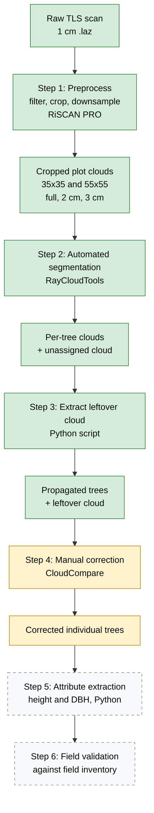

# Workflow: Individual-Tree Segmentation from TLS Point Clouds

This document describes the full workflow in more detail than the pipeline overview in the README. It covers the inputs, outputs, tools, commands, folder locations, quality checks, and status of every stage.

The workflow follows the Q-ForestLab processing pipeline (Steps 1–4), then adds two stages that come after it: attribute extraction and field validation.

**Study data:** Blue Mountains native forest monitoring plots (temperate dry sclerophyll forest), scanned by University of Ghent collaborators. The processed plot is **WSL_ML2A**. A second raw scan, **WSF_ML1C**, is in the raw data folder but has not been processed.

**Status key:** Done = carried out. In progress = started, not finished. Planned = method designed, not started.

---

## 1. Workflow at a glance



| Step | Name | Tool | Status |
|---|---|---|---|
| 1 | Preprocessing | RiSCAN PRO | Done |
| 2 | Automated segmentation | RayCloudTools | Done |
| 3 | Leftover cloud extraction | Python (`scripts/tree_extraction.py`) | Done |
| 4 | Manual segmentation correction | CloudCompare | In progress |
| 5 | Attribute extraction (height, DBH) | Python | Planned |
| 6 | Field validation | Python, field inventory | Planned |

Manual correction (Step 4) is the most time-consuming stage.

---

## 2. Data flow

| Stage | Input | Output | Location in the working folder | In this repo? |
|---|---|---|---|---|
| Raw scan | Registered TLS scans | 1 cm `.laz` per plot | `data/raw/WSL_ML2A/`, `data/raw/WSF_ML1C/` | Small crop only |
| Step 1 | Raw `.laz` | Cropped plot clouds in `full`, `2cm`, `3cm` versions (`.ply`, `.las`, `.laz`) | `data/cropped/WSL_ML2A/{35x35,55x55}/{full,2cm,3cm}/` | Small crop only |
| Step 2 | Cropped `.ply` | Ray cloud, terrain mesh, segmented cloud, per-tree clouds, tree meshes, unassigned cloud | `outputs/WSL_ML2A/<crop>/<res>/` with subfolders `raycloud/`, `terrain/`, `segmentation/`, `metadata/`, `unassigned/`, `trees/{clouds,metadata,meshes}/` | A few trees |
| Step 3 | Plot cloud and per-tree clouds | `*_propagated.las` per tree, leftover cloud, resume state | `outputs/WSL_ML2A/55x55/3cm/output_script/` | No (large) |
| Step 4 | Per-tree clouds and leftover cloud | Corrected trees, versioned working files | `outputs/WSL_ML2A/55x55/3cm/trees/cloud_correct/`, `.../segmentation/` | A few trees |
| Step 5 | Corrected trees | Height and DBH table | Not yet created | Planned |
| Step 6 | Height and DBH table, field inventory | Agreement statistics | Not yet created | Planned |

Two crop sizes (35x35 and 55x55) and two downsampled resolutions (2 cm, 3 cm) were processed. Manual correction so far is only on the **55x55 / 3 cm** run.

---

## 3. Step-by-step detail

### Step 1. Preprocessing (RiSCAN PRO)

**Purpose.** The full TLS dataset is too large to process in one go. This step reduces it to plot-sized clouds that RayCloudTools can handle.

**Procedure.**

1. Open the registered scan project in RiSCAN PRO (Q-ForestLab setup).
2. Filter the data to remove noise and unwanted returns.
3. Crop the cloud to the region of interest. Two crop sizes were made: 35x35 and 55x55.
4. Downsample the crops. Two resolutions were made: 2 cm and 3 cm. A `full` (not downsampled) version of each crop is also kept.
5. Export the clouds as `.ply` (needed by RayCloudTools). `.las` and `.laz` copies also exist.

**Quality checks.**

- Check the cropped cloud covers the intended area and is cut cleanly at the edges.
- Check the downsampled point counts against the full version.

> TODO: filter settings used, downsampling method, point counts before and after, crop centre and coordinate system, scan date.

### Step 2. Automated segmentation (RayCloudTools)

**Purpose.** Produce a first, automated segmentation of the plot into individual trees.

**Commands** (example file names from the pipeline document):

```bash
rayimport 2025-05-31_DSF_CP1B_1cm_30m_pcs.ply ray 0,0,-0.1 --max_intensity 0
rayextract terrain 2025-05-31_DSF_CP1B_1cm_30m_pcs_raycloud.ply --gradient 2
rayextract trees 2025-05-31_DSF_CP1B_1cm_30m_pcs_raycloud.ply \
    2025-05-31_DSF_CP1B_1cm_30m_pcs_raycloud_mesh.ply \
    --max_diameter 0.9 --height_min 10
raysplit 2025-05-31_DSF_CP1B_1cm_30m_pcs_raycloud_segmented.ply seg_colour
treesplit 2025-05-31_DSF_CP1B_1cm_30m_pcs_raycloud_trees.txt per-tree
```

| Command | What it does | Main parameter |
|---|---|---|
| `rayimport` | Converts the cloud to a ray cloud, keeping the sensor position | `--max_intensity` |
| `rayextract terrain` | Fits a terrain mesh to the ground | `--gradient` |
| `rayextract trees` | Builds tree structures from the ray cloud and terrain | `--max_diameter`, `--height_min` |
| `raysplit` | Splits the segmented cloud by segment colour | `seg_colour` |
| `treesplit` | Writes one file per tree | `per-tree` |

**Parameters to check and optimise:** `--gradient`, `--max_diameter` and `--height_min`.

**Output.** Per-tree clouds (`trees/clouds/*_segmented_N.ply`), tree metadata (`trees/metadata/*.txt`), tree meshes, a terrain mesh, and an unassigned cloud (`unassigned/*_segmented_-1.ply`) holding points that were not given to any tree.

**Quality checks.** Look at the result in 3D. This output is treated as a preliminary result, not a finished one.

> TODO: the parameter values used for each crop and resolution, and why they were chosen. Note which run is the one used for correction.

### Step 3. Extract the leftover point cloud (Python)

**Purpose.** After Step 2, some points in the plot cloud are not in any tree. This step separates the points that belong to the segmented trees from the points that do not. The remainder (the **leftover cloud**) is loaded in Step 4, so missed points can be given to the right tree.

**Script.** `scripts/tree_extraction.py`. The method follows the Q-ForestLab `treeseg_propagation` manual.

**Inputs and arguments.**

| Argument | Meaning |
|---|---|
| `plot_file` | Path to the plot point cloud |
| `trees_folder` | Folder with the per-tree clouds |
| `opath_folder` | Output folder for the propagated trees |
| `opath_plot` | Output file for the leftover cloud |
| `--distance_th` | Distance threshold (default `0.01`) |

**How it works.**

1. Load the plot cloud and build a boolean mask that marks every point as unassigned.
2. For each tree cloud, take the plot points inside the tree's bounding box (a fast pre-filter).
3. Compute the distance from those points to the tree cloud. Points closer than `distance_th` belong to the tree.
4. Save those points as `<tree>_propagated.las` and mark them as assigned in the mask.
5. After all trees, save the points that are still unassigned as the leftover cloud.

**Resume support.** Progress is written to `mask_plot.npy` and `processed_trees.json`, so an interrupted run can continue. These files are written to the folder the script is run from, not the output folder. The JSON file stores absolute paths.

**Requirements.** Python with `open3d`, `numpy` and `laspy`. Reading `.laz` needs `lazrs` or `laszip`.

**Output (55x55 / 3 cm run).** A leftover `.las`, a `trees_propagated/` folder with 162 `*_propagated.las` files, and the two resume-state files.

> TODO: confirm which plot cloud was passed as `plot_file` (the 3 cm cloud or the full-resolution crop) and the `--distance_th` value used.

### Step 4. Manual segmentation correction (CloudCompare)

**Purpose.** Turn the automated result into a reliable set of individual trees. This is the most time-consuming stage.

**Why it is needed.** Automated segmentation makes errors, especially where crowns overlap and towards the outer crown. Similar scores can hide different kinds of error, so each tree needs to be checked by eye.

**Typical corrections.**

- Split a segment that contains two or more trees.
- Merge segments that belong to one tree.
- Move branches that were given to the wrong neighbouring tree. Deciding branch ownership in overlapping crowns is the hardest part.
- Remove non-tree material, such as understorey, ground points and noise.
- Move points between a tree and the leftover cloud.

**Procedure.**

1. Load the per-tree clouds and the leftover cloud into CloudCompare.
2. Go through the trees one at a time.
3. Use the segmentation tools to cut, merge, reassign or delete points.
4. Save each corrected tree to `trees/cloud_correct/`.
5. Save a new numbered working version each session (the segmentation folder holds `seg_v01` to `seg_v11`, `work_v01` to `work_v04` and `clean_v01` to `clean_v03`), so any step can be undone.

**Proposed acceptance checks for a finished tree.** These are proposed, not yet confirmed as the final rules:

- The stem is continuous from the ground to the crown.
- No branches from neighbouring trees are included.
- The crown is not cut off without a reason.
- Non-tree material is removed.

**Point accounting.** The points in the corrected trees plus the points left in the leftover cloud should account for the points in the starting plot cloud. A large mismatch means points were lost or duplicated during editing.

**Limits.** One operator makes the decisions, so some are subjective. The corrected trees are derived by editing the automated output, so they are not independent of it.

> TODO: how many trees are corrected out of the total, how many are flagged uncertain, time spent, and whether the unedited automated output was kept for before and after comparison.

### Step 5. Attribute extraction (Python) — planned

**Purpose.** Measure tree attributes from the corrected trees.

- **Height.** Highest point of the tree minus the ground level beneath it, using the terrain mesh from Step 2.
- **DBH (diameter at breast height, 1.3 m).** Take a thin horizontal slice of the stem at 1.3 m above the ground and fit a circle to it (RANSAC circle fit). Mark trees where the fit is poor, or where the stem forks near 1.3 m.
- **Optional.** Crown area, woody volume from TreeQSM, and above-ground biomass.

Tree age is **not** estimated, because there is no validated method or data for it.

### Step 6. Field validation — planned

**Purpose.** Compare the TLS-derived measurements with the field inventory.

1. Match corrected trees to field-inventory records. Matching is restricted to the same site and quadrant, one tree to one record, and uses an assignment method (Hungarian algorithm) with explicit exclusion rules. Multi-stemmed trees are combined using the quadratic mean diameter.
2. Compare DBH, and height if the inventory has it. Use Bland–Altman limits of agreement for DBH.
3. Report mismatches openly, including trees that cannot be told apart by species, stem count and DBH.

Notes:

- The field inventory used for validation is a separate Excel file. It is **not** `TreeData.csv`, which has been audited but has no within-plot tree coordinates.
- Matching on the inventory's own measurements risks circular results, so the report states this limit.

---

## 4. Reproducibility checklist

For every run, record:

| Item | Where |
|---|---|
| Input file name and crop | Folder name, `SAMPLE_INFO.md` |
| Tool and version | README, `environment/` |
| Parameters (Step 2 and 3) | Table in this document (TODO) |
| Working-file versions (Step 4) | `segmentation/` version numbers |
| Date and who ran it | Commit message or log |
| Time spent on manual correction | Review log (TODO: start one) |

Start a simple review log now if there isn't one: for each tree record the error type, the edit made, whether you are unsure, and the time taken. Do not rebuild times from memory later.

## 5. Open items

1. Fill in the Step 1 and Step 2 settings and point counts.
2. Confirm the plot cloud and threshold used in Step 3.
3. Count corrected trees and record the time spent.
4. Confirm the acceptance checks in Step 4.
5. Locate the field inventory and check whether it contains tree heights.
6. Decide where the full data is hosted and add the link to the README.

## 6. Tools

| Tool | Used in |
|---|---|
| RiSCAN PRO | Step 1 |
| RayCloudTools (`rayimport`, `rayextract`, `raysplit`, `treesplit`) | Step 2 |
| Python (`open3d`, `numpy`, `laspy`) | Steps 3, 5, 6 |
| CloudCompare | Step 4 |
| TreeQSM | Step 5, optional |

## 7. References

- Q-ForestLab `rayextract` manual: https://github.com/qforestlab/rayextract-manual
- Q-ForestLab TLS course: https://github.com/qforestlab/ARS_TLS_course
- Q-ForestLab `treeseg_propagation`: https://github.com/qforestlab/treeseg_propagation
- Q-ForestLab segmentation correction: https://github.com/qforestlab/segmentation_correction
- Cherlet et al. (2026), *ISPRS Journal of Photogrammetry and Remote Sensing*, vol. 231, pp. 230–247.
- Calders et al. (2020).
